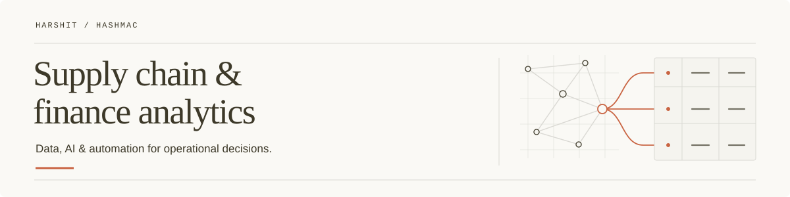

<picture>
  <source media="(prefers-color-scheme: dark)" srcset="./assets/profile-banner-dark.svg">
  <source media="(prefers-color-scheme: light)" srcset="./assets/profile-banner-light.svg">
  
</picture>

# Harshit Pandey

My speciality is **supply chain and finance analytics**. I work on questions that look simple until you try to answer them: what do we actually need to buy, what have we already committed to, and what is likely to delay the project?

I’m interested in the connection between those answers and the everyday work behind them: planning materials, consolidating requirements, following up on orders, checking receipts, and keeping spending visible.

## The problems I work on

- **Material planning and procurement:** bringing bills of materials, available stock, open purchase orders, and project requirements together so purchasing decisions start with a complete picture.
- **Supply chain visibility:** understanding supplier lead times, outstanding quantities, and gaps between what was ordered, expected, and received.
- **Finance analytics:** tracking purchase commitments and budget adherence, and connecting procurement decisions to their financial consequences.
- **Data quality:** questioning mismatched records, inconsistent item descriptions, and missing information before trusting the numbers built on top of them.

## What I’m building now

I’m working on in-house procurement, project management, and CRM workflows, using AI-assisted development to turn operational requirements into working software.

The procurement work connects material requirements, stock, purchase orders, receipts, and approvals. I want it to be easier to see what needs attention, who needs to act, and which missing information could become an urgent problem later.

Much of this work is private and still in progress. The public repositories here are only part of what I’m working on.

## How I approach the work

I start with how people actually get things done, including the requirements, follow-ups, and decisions scattered across email and WhatsApp. That is often where the exceptions become visible.

From there, I work through the records, handoffs, and checks a workflow needs. I care about whether the data can be trusted, whether an approval is clear, and whether someone can tell what to do next. Those details shape the automation.

## Other interests

I also explore CAD and simulation. I like understanding how a system behaves, whether that means a physical design, a material plan, or the software supporting a team’s work.

---

[Repositories](https://github.com/HashMac?tab=repositories) · [Stars](https://github.com/HashMac?tab=stars)
